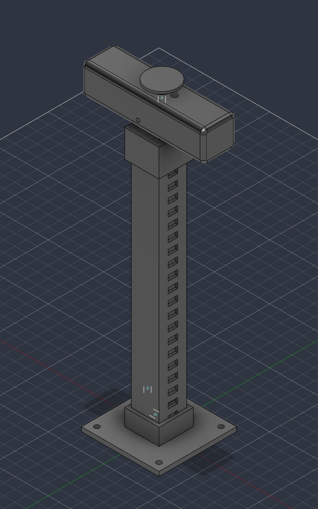
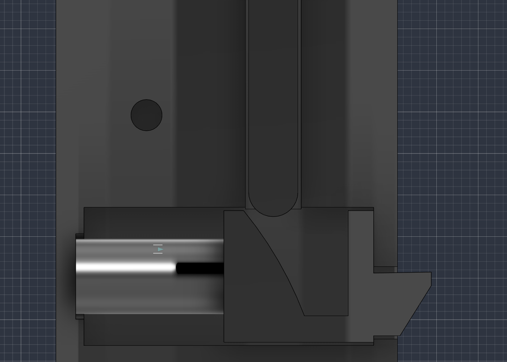

# Handle Mechanism

## Background
Standard telescoping handles use a spring-loaded pin that drops into holes in the outer tube, which only allows 2 or 3 heights.

## Ratchet design

## Key numbers

| Parameter | Value |
|---|---|
| Rod size | 25 mm square aluminum |
| Travel | 172.5 mm |
| Lock pitch (test rig) | 10 mm, 21 positions over 200 mm |
| Pawl spring | Lee Spring LC 016B 05 S, 2.4 N installed, 4.0 N retracted |

## Test rig

A single-rod, fully 3D-printed version of the mechanism, used to test the ratchet before fitting it to the suitcase.

- Outer tube 25 x 25 mm with a row of lock slots; inner tube 19 x 19 mm
- Module at the bottom of the inner tube: split housing, pawl, pawl spring
- Button in the grip drives a release rod down onto a curved cam on the pawl
- Two return springs under the button lift the rod back off the cam
- Springs: 3 x Lee Spring LC 016B 05 S; everything else is printed in PETG
- Files: `parts/handle/cad/ratchet-test-rig.f3d` / `.step`, STLs in `parts/handle/exports/ratchet-test-rig/`

## Downward load

## Testing

